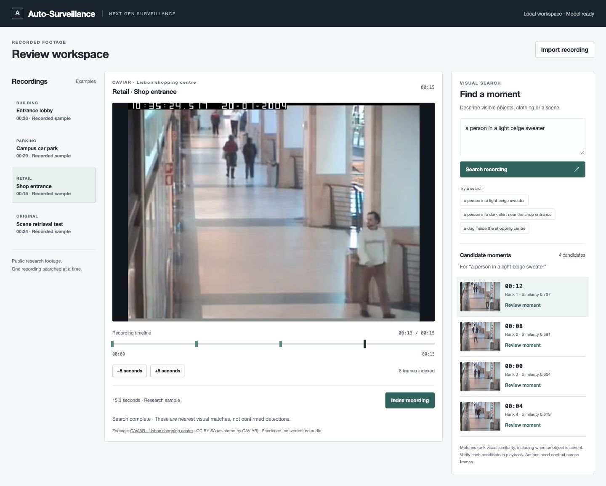
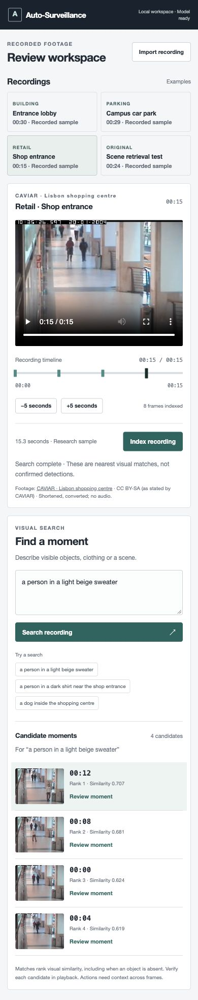
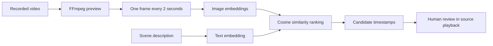

<div align="center">

# Auto-Surveillance

### Next gen surveillance

**Search · Locate · Review**

Find candidate moments in recorded camera footage using natural-language descriptions, then inspect the source video with timestamped playback.


[✨ Capabilities](#capabilities) · [🚀 Setup](#setup) · [▶️ Run](#run) · [🎬 Examples](#examples) · [🧠 Architecture](#architecture) · [🧪 Validation](#validation) · [🗺️ Roadmap](#roadmap)

</div>



*The review workspace: recording library, source footage, candidate timeline markers, and visual search results. Screenshot uses public CAVIAR research footage; see [media attribution](ATTRIBUTION.md).*

> **Research prototype.** The app retrieves visually similar frames for human review. It does not yet verify events, reliably reject absent objects, or provide conversational video analysis. A similarity score is a ranking signal, not detection confidence.

<a id="capabilities"></a>

## ✨ What it does

| Capability | Current behavior |
|---|---|
| 🔎 Natural-language search | Describe visible clothing, objects or scenes to retrieve candidate frames. |
| 🎞️ Recorded-footage review | Select a prepared example or import a short recording. |
| 📍 Timestamped results | Review ranked thumbnails and jump directly to a candidate moment. |
| ⏱️ Timeline navigation | See match locations and move five seconds backward or forward for context. |
| 🏢 Multiple example settings | Try a building lobby, campus parking area and retail entrance. One recording is searched at a time. |
| 💻 Local processing | FFmpeg prepares footage; Ollama embeds images and queries locally by default. No paid API or API key is needed. |
| ♻️ Reusable indexes | Reopening the same footage with the same model reuses cached embeddings. |

**A straightforward review flow:** select a recording → index its frames → describe what you want to find → inspect candidate moments in playback.

<a id="setup"></a>

## 🚀 Get started

### 1 · Install the prerequisites

| Requirement | Purpose |
|---|---|
| **Python 3.10+** | Runs the server and retrieval engine using the standard library. No `pip install` is required. |
| **FFmpeg + ffprobe** | Validate recordings, prepare browser previews and extract frames. |
| **Ollama with multimodal embedding support** | Runs the image/text embedding model. |
| **Modern browser** | Displays the review workspace and video player. |

On macOS, install FFmpeg with [Homebrew](https://brew.sh/):

```bash
brew install ffmpeg
```

Install [Ollama](https://ollama.com/), then open its app or keep this running in a separate terminal:

```bash
ollama serve
```

### 2 · Clone the repository

```bash
git clone https://github.com/BrunoMelicio/video-footage-search.git
cd video-footage-search
```

The repository directory retains its original name; the application is **Auto-Surveillance**.

### 3 · Download the embedding model

```bash
ollama pull embeddinggemma-2:440m
```

The checkpoint is approximately **714 MB**. This project has been exercised with Ollama **0.40.12** on Apple M3 hardware; the original demo was also verified with 0.40.2.

### 4 · Prepare the camera examples

```bash
python3 scripts/prepare_review_samples.py
```

This downloads public CAVIAR and MEVA recordings and creates three short previews in ignored `runtime/demo/`. Downloads require internet access; subsequent default indexing and search use local services. Source URLs, requested byte ranges and file hashes are recorded in `runtime/demo/sources.json`.

Without this step, the included **Original · Scene retrieval test** remains available.

<a id="run"></a>

## ▶️ Run the workspace

```bash
python3 server.py
```

Open **[http://localhost:8001](http://localhost:8001)**.

1. Select a recording from the library.
2. Click **Index recording** and wait until it is ready.
3. Choose an example query or enter a scene description.
4. Click **Review moment** or a timeline marker.
5. Use **−5 seconds / +5 seconds** to inspect the surrounding footage.

Use **Import recording** for your own footage, up to **120 seconds / 50 MB**. The browser preview is converted to H.264 MP4 with audio removed; audio is not indexed. Temporary original uploads are deleted after processing. Generated previews, thumbnails and embeddings remain in `runtime/` until removed locally.

### ⚙️ Configuration

| Variable | Default | Use |
|---|---|---|
| `PORT` | `8001` | Change the web server port. |
| `OLLAMA_URL` | `http://localhost:11434` | Select the Ollama endpoint. A remote endpoint receives the extracted images and query text. |
| `EMBED_MODEL` | `embeddinggemma-2:440m` | Select a compatible image/text embedding model. Changing models requires reindexing. |

```bash
PORT=8002 python3 server.py
```

The server binds to **127.0.0.1**. Only one indexing job runs at a time. The workspace has no authentication or production deployment configuration.

<a id="examples"></a>

## 🎬 Try real camera footage

These are short public research examples. The parking clip is a car park, and the retail clip shows a shop entrance rather than a checkout.

| Setting | Source | Length | Example query | Observed top frame |
|---|---|---:|---|---:|
| 🏢 Building lobby | [CAVIAR](https://homepages.inf.ed.ac.uk/rbf/CAVIARDATA1/) · Grenoble | 30 s | `a person wearing a blue jacket` | 00:00 |
| 🚙 Parking area | [MEVA](https://mevadata.org/) · School G424 | ~30 s | `a person wearing red near a white pickup truck` | 00:12 |
| 🛍️ Retail entrance | [CAVIAR](https://homepages.inf.ed.ac.uk/rbf/CAVIARDATA1/) · Lisbon | ~15 s | `a person in a light beige sweater` | 00:12 |

The described subjects were visible at these timestamps during exploratory inspection. These examples are **not a held-out surveillance accuracy benchmark**. UI timestamps are relative to the sample clip, not reconstructed camera wall-clock times.

### 📱 Responsive review

<details>
<summary>View the mobile workspace</summary>



</details>

<a id="architecture"></a>

## 🧠 How it works



| Component | Implementation |
|---|---|
| Web server | Python standard-library `ThreadingHTTPServer`. |
| Interface | HTML, CSS and vanilla JavaScript; no frontend build step. |
| Video processing | FFmpeg / ffprobe; browser-compatible H.264 previews. |
| Image + text embeddings | `embeddinggemma-2:440m` through Ollama's `/api/embed`. |
| Retrieval | Normalized vectors and cosine similarity; at most five results, spaced at least four seconds apart. |
| Storage | Local files and JSON indexes in ignored `runtime/`; no vector database. |

The model has approximately **438.8M parameters** and produces **768-dimensional** vectors in the tested configuration. Image input contains only frame pixels; filenames, source labels and expected query answers are not passed into embeddings.

Text queries use the [model card's](https://huggingface.co/google/embeddinggemma-2) task prefix:

```text
task: search result | query: YOUR_DESCRIPTION
```

Cache identity includes video content, model digest, sampling interval and pipeline version. Source changes or model changes produce a new index.

<a id="validation"></a>

## 🧪 Validation and practical limits

### Run the checks

```bash
# Offline unit checks; no inference required.
python3 -m unittest discover -s tests -v

# Original three-scene retrieval check; requires Ollama and the model.
python3 evaluate.py

# Exploratory camera-footage queries, including absent-object controls.
# Prepare the camera examples first.
python3 scripts/evaluate_review.py
```

**Current evidence:** nine unit tests pass. The original flowers/landscape/rabbit retrieval cases pass. Browser checks exercised selecting and indexing all three camera examples, searching, candidate playback, desktop layout and mobile layout without horizontal overflow.

Camera-footage rankings are written to `runtime/review-evaluation.json`. They are diagnostic results, not accuracy scores. Unit tests cover sampling boundaries, vector validation, dimension mismatches, temporal result spacing, video ID validation and sample selection.

### What the camera tests revealed

An absent-dog query still returned candidate frames in all three recordings:

| Recording | Top similarity for absent-dog query |
|---|---:|
| Lobby | 0.718 |
| Parking | 0.679 |
| Retail | 0.688 |

The lobby's correct blue-jacket query scored **0.687**, lower than the absent-dog query. Raw cosine cannot be treated as a calibrated probability or an arbitrary universal detection threshold.

- **Single frames do not establish actions.** “Left a bag behind,” “never exited” or “stole an item” require temporal evidence.
- **Two-second sampling can miss brief events.** Small subjects, occlusion and low-light footage need separate evaluation.
- **Search always returns nearest candidates.** There is no reliable “no match” decision yet.
- **The current scope is short recorded clips.** Live camera ingestion, hours-long recordings, cross-camera tracking and conversational follow-ups are planned.

<a id="roadmap"></a>

## 🗺️ Where this is going

- [x] Local image/text retrieval with source timestamps.
- [x] Review workspace with a recording library, timeline markers and playback controls.
- [x] Building, parking and retail camera examples.
- [x] Exploratory queries that expose absent-object failures.
- [ ] Evaluate retrieval with independently labelled intervals, absent objects and varied camera conditions.
- [ ] Retrieve short clips and verify candidate observations across adjacent frames.
- [ ] Support long recordings, persistent camera metadata and time-range filters.
- [ ] Add grounded follow-ups such as “show ten seconds earlier” and “only this camera.”
- [ ] Add bookmarks, reviewer notes and context-clip exports.
- [ ] Add access control, retention policies and audit records for deployment.

See [the product direction and experiment notes](REVIEW-DIRECTION.md) for the proposed increments.

## 📚 Project guide

| File / directory | Purpose |
|---|---|
| [`server.py`](server.py) | Local HTTP API, uploads, jobs and media serving. |
| [`engine.py`](engine.py) | Video indexing, embeddings and retrieval. |
| [`static/`](static/) | Review interface. |
| [`scripts/`](scripts/) | Sample preparation and exploratory evaluation. |
| [`tests/`](tests/) | Unit checks and original retrieval queries. |
| [`REVIEW-DIRECTION.md`](REVIEW-DIRECTION.md) | Findings and next product milestones. |
| [`DESIGN.md`](DESIGN.md) | Current interface direction and original design history. |
| [`ATTRIBUTION.md`](ATTRIBUTION.md) | Sample footage and screenshot credits. |

## 📜 Media and third-party attribution

Camera examples are downloaded locally and excluded from Git. README screenshots contain derived CAVIAR frames, credited to the **EC Funded CAVIAR project / IST 2001 37540**, under the source page's **CC BY-SA** terms. MEVA footage is credited to **Kitware / IARPA**, **CC BY 4.0**. The included original teaching reel uses MDN CC0 flowers and Blender Foundation's *Big Buck Bunny*, CC BY 3.0.

See [ATTRIBUTION.md](ATTRIBUTION.md) for source URLs and modifications. Third-party footage and model terms are separate from this repository's source code. This repository currently does not declare a source-code license.
